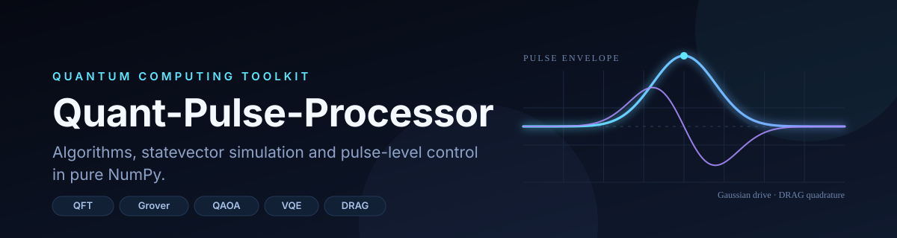
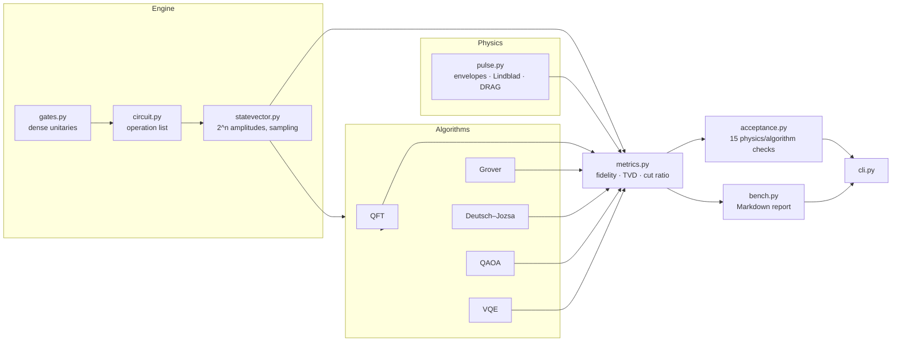

# Quant-Pulse-Processor



### Quantum algorithms you can read in one sitting — and the pulse-level physics underneath them.

[](https://github.com/MrKyaw/Quant-Pulse-Processor/actions/workflows/ci.yml)
[](pyproject.toml)
[](tests)
[](tests)
[](pyproject.toml)
[](pyproject.toml)
[](LICENSE)

**A dependency-light quantum computing toolkit in pure Python + NumPy:** a statevector engine, five canonical algorithms checked against exact references, and a pulse-level transmon simulator with `T1`/`T2` relaxation and DRAG leakage suppression.

[Report Bug](https://github.com/MrKyaw/Quant-Pulse-Processor/issues/new?template=bug_report.yml) · [Request Feature](https://github.com/MrKyaw/Quant-Pulse-Processor/issues/new?template=feature_request.yml) · [Ask Question](https://github.com/MrKyaw/Quant-Pulse-Processor/issues/new?template=question.yml)

**⭐ Star this repo if you find it useful! ⭐**

---

## Why this exists

Most quantum-computing repositories are either a wrapper around a vendor SDK or a single notebook. This one is deliberately different:

- **One dependency.** `numpy`. No Qiskit, Cirq, PennyLane or SciPy in the runtime path — every unitary, gradient and master-equation step is visible in the source.
- **Exact references, not golden files.** The QFT is compared with the analytic DFT matrix; VQE is compared with dense diagonalisation; Grover is compared with the amplitude-amplification formula.
- **Gate level and pulse level in the same repo.** The circuit layer answers *what* a quantum algorithm computes; the pulse layer answers *how* a transmon is actually driven, including the leakage that a DRAG correction removes.
- **Small enough to audit.** ~1,300 statements of library code, 250 tests, and a reproducible benchmark report.

It is a portfolio project for quantum-software, research-engineering and scientific-computing roles — and a readable reference for anyone learning how these algorithms fit together.

---

## System architecture



**Three layers, one convention.** Qubit 0 is always the least significant bit. Gate matrices are dense and ordered so the first listed wire is the most significant bit of the gate's own index; global operators use the state basis directly. That single convention is what lets the QFT circuit match the DFT matrix to `1e-15`.

| Layer | Module | What it gives you |
| --- | --- | --- |
| Engine | `gates.py`, `circuit.py`, `statevector.py` | 14 named gates, arbitrary unitaries, sampling, partial trace, entropy |
| Algorithms | `algorithms/` | QFT, Grover, Deutsch–Jozsa, QAOA, VQE — each with an exact oracle of correctness |
| Physics | `pulse.py` | Gaussian/square/DRAG envelopes, Rabi dynamics, 2- and 3-level simulation, Lindblad decay |
| Quality | `acceptance.py`, `bench.py` | 15 acceptance cases and a reproducible benchmark report |

Full design notes: [`docs/ARCHITECTURE.md`](docs/ARCHITECTURE.md) · Math and conventions: [`docs/METHOD.md`](docs/METHOD.md) · Measured results: [`docs/BENCHMARKS.md`](docs/BENCHMARKS.md).

---

## User action: see it run in 60 seconds

```bash
git clone https://github.com/MrKyaw/Quant-Pulse-Processor.git
cd Quant-Pulse-Processor
python -m venv .venv && source .venv/bin/activate
pip install -e ".[dev]"
```

Then:

```bash
quantpulse demo        # Bell, GHZ, QFT, Grover, DJ, QAOA, VQE, pi-pulse, DRAG
quantpulse eval        # 15 acceptance checks with measured values
quantpulse bench       # full benchmark report (about 40 s)
quantpulse info        # version and environment
```

**Use it as a library:**

```python
import numpy as np
from quantpulse import Circuit
from quantpulse.algorithms import run_grover, optimize_qaoa, RING6_EDGES

# A circuit is an inspectable object, not an opaque transpiler call.
bell = Circuit(2).h(0).cnot(0, 1)
print(bell.probabilities())        # [0.5 0.  0.  0.5]
print(bell.depth, bell.gate_counts())  # 2 {'cnot': 1, 'h': 1}

# Grover: the marked state is 1011.
result = run_grover(4, [11], shots=4096, seed=0)
print(result.top_bitstring, result.success_probability)  # 1011 0.9613

# QAOA on a six-node ring with two chords.
qaoa = optimize_qaoa(6, RING6_EDGES, depth=2, steps=60, restarts=2, seed=3)
print(qaoa.ratio)                  # 0.879
```

**Drive a transmon:**

```python
from quantpulse.pulse import pi_pulse, simulate_three_level

_, drive, quadrature = pi_pulse(12.0, 0.02, sigma=2.0, beta=0.75)  # DRAG beta
result = simulate_three_level(drive, quadrature, 0.02, anharmonicity=-1.2)
print(result.final_population, result.final_leakage)  # 0.984 6.4e-04
```

---

## What is inside

### Circuit engine

- 14 named gates (`H`, `X`, `Y`, `Z`, `S`, `T`, `SX`, `CNOT`, `CZ`, `SWAP`, `TOFFOLI`, …) plus `RX`/`RY`/`RZ`, phase and controlled-phase.
- Arbitrary `k`-qubit unitaries and full-width operators, applied by tensor contraction.
- Circuit inversion, depth, gate counts and an ASCII drawing.
- Seeded shot sampling, reduced density matrices, von Neumann entropy, Pauli expectations.

### Algorithms (each scored against an exact reference)

| Algorithm | Implementation | Exact reference |
| --- | --- | --- |
| **QFT / inverse QFT** | H + controlled phases + swaps | dense DFT matrix |
| **Grover** | phase oracle + diffusion, optimal iteration count | `sin²((2r+1)θ)` |
| **Deutsch–Jozsa** | phase kickback on one ancilla | constant vs balanced |
| **QAOA (MaxCut)** | CNOT–RZ–CNOT cost layers, `RX(2β)` mixer | brute-force max cut |
| **VQE (TFIM)** | RY + CNOT ladder ansatz, parameter-shift gradients | dense diagonalisation |

### Pulse-level control

- Gaussian, square and DRAG envelopes with analytic pulse area.
- Two-level rotating-frame Hamiltonian `H = (Ω(t)X + δZ)/2`, exact step propagators.
- Lindblad master equation with amplitude damping (`T1`) and pure dephasing (`T2`).
- Three-level transmon with `|0⟩ → |1⟩ → |2⟩` coupling (`√2` enhancement) and anharmonicity.
- DRAG quadrature `Ω_Q = -β Ṙ/α` that suppresses leakage by more than two orders of magnitude.

---

## Real test results

Measured on **Python 3.12.8 / NumPy 2.5.4** on an Apple M3 (8 GB), 20 October 2026.

```
$ python -m pytest -q
........................................................................ [ 28%]
........................................................................ [ 57%]
........................................................................ [ 86%]
..................................                                       [100%]
250 passed, 1 deselected in 31.9s

$ python -m pytest -q --cov=quantpulse
TOTAL   1277 statements   324 branches   96% coverage

$ ruff check src tests
All checks passed!
```

The 250 tests fall into six groups:

| Group | Examples | What is asserted |
| --- | --- | --- |
| Gate algebra | unitarity of all gates, CNOT/Toffoli truth tables, `S² = Z`, `T² = S` | dense matrices are correct and unitary |
| State math | sampling determinism, Bell reduced state, entropy, Pauli expectations | the engine obeys linear algebra |
| Circuits | Bell, GHZ, inversion, depth, global unitaries | composition and bookkeeping |
| Algorithms | QFT = DFT, Grover ≥ 0.94, DJ constant/balanced, QAOA ratios, VQE energy | algorithm-level correctness |
| Physics | Rabi `sin²(Ωt/2)`, `T1`/`T2` decay, DRAG leakage | the simulation matches analytic solutions |
| Interfaces | CLI JSON contracts, exit codes, Markdown rendering | the product surface works |

### Acceptance suite (`quantpulse eval`)

Every case is a physical or mathematical invariant, not a stored snapshot:

```
$ quantpulse eval
  Scope       Case                           Status  Measurement                             Time
  ----------  -----------------------------  ------  --------------------------------------  --------
  circuits    Bell state correlations        PASS    max |P - target| = 1.11e-16             0.3 ms
  circuits    GHZ-3 state                    PASS    max |P - GHZ| = 1.11e-16                0.1 ms
  algorithms  QFT |0...0> is uniform         PASS    max |amp - 1/sqrt(N)| = 8.33e-17        0.4 ms
  algorithms  QFT circuit equals DFT matrix  PASS    max |circuit - DFT| = 1.42e-15          0.5 ms
  algorithms  Inverse QFT round trip         PASS    max |QFT^-1 QFT psi - psi| = 3.86e-16   20.9 ms
  algorithms  Grover, 4 qubits               PASS    success probability = 0.9613            0.6 ms
  algorithms  Grover, 5 qubits               PASS    success probability = 0.9992            0.7 ms
  algorithms  Deutsch-Jozsa, constant        PASS    P(input = 0) = 1.0000                   2.2 ms
  algorithms  Deutsch-Jozsa, balanced        PASS    P(input = 0) = 1.29e-134                2.2 ms
  algorithms  QAOA MaxCut approximation      PASS    approximation ratio = 0.8787            1.9 s
  algorithms  VQE ground-state energy        PASS    |E - E_exact| = 1.86e-10                0.7 s
  pulse       Rabi pi-pulse population       PASS    P(|1>) after pi-pulse = 1.000000        8.0 ms
  pulse       T1 amplitude damping           PASS    |P(T1) - 1/e| = 1.11e-16                170 ms
  pulse       T2 coherence decay             PASS    ||rho01(T2)| - e^-1/2| = 5.55e-17       169 ms
  pulse       DRAG leakage suppression       PASS    leakage(DRAG) / leakage(bare) = 0.0496  25 ms

15/15 cases passed
```

---

## Benchmarks (real numbers)

Reproduce with `quantpulse bench --write`. Full tables: [`docs/BENCHMARKS.md`](docs/BENCHMARKS.md).

| Measurement | Result |
| --- | --- |
| QFT on 10 qubits | 0.96 ms, uniform-amplitude error `2.4e-17` |
| Grover, 5-qubit search | `0.9992` success probability at 4 iterations |
| Grover, 7-qubit search | `0.9956` at 8 iterations |
| QAOA, 6 nodes, depth 2 | `0.879` approximation ratio (5.1 s) |
| QAOA, 6 nodes, depth 4 | `0.935` approximation ratio (17.3 s) |
| VQE, 2-qubit TFIM | error `1.9e-10` against exact diagonalisation |
| DRAG leakage suppression | `1.28e-2 → 6.13e-5` (208× lower) |
| Lindblad checks | `T1` error `1.1e-16`, `T2` error `2.0e-15` |

> Timings are wall-clock medians on the machine that generated the report. This is a dense statevector simulator: it scales as `2^n` and is intended for registers up to roughly 15 qubits.

---

## Scope and honest limitations

- **Simulation, not hardware.** No device backend, calibration pipeline or error-correction decoder.
- **Dense statevectors.** Memory grows exponentially; 20 qubits already needs 16 MB per amplitude vector before gate workspace.
- **One transmon at a time.** The pulse layer models a single anharmonic oscillator, not a coupled multi-qubit chip.
- **QAOA gradients** use central differences because layer angles are shared across wires; VQE uses the exact parameter-shift rule.
- **Not a replacement for Qiskit.** It is a compact, auditable reference implementation for learning and review.

---

## Project structure

```
.
├── src/quantpulse/
│   ├── gates.py             # dense gate library
│   ├── statevector.py       # sampling, partial trace, entropy
│   ├── circuit.py           # operations, execution, inspection
│   ├── metrics.py           # fidelity, TVD, cut ratio
│   ├── optim.py             # Adam + parameter-shift gradients
│   ├── pulse.py             # envelopes, Lindblad, transmon leakage
│   ├── algorithms/          # qft, grover, deutsch_jozsa, qaoa, vqe
│   ├── acceptance.py        # 15 physics/algorithm checks
│   ├── bench.py             # benchmark harness + Markdown
│   └── cli.py               # demo | eval | bench | info
├── tests/                   # 250 tests
├── docs/
│   ├── ARCHITECTURE.md
│   ├── METHOD.md
│   ├── BENCHMARKS.md
│   └── assets/banner.svg
├── .github/workflows/ci.yml
├── pyproject.toml
└── Makefile
```

---

## Development

```bash
make install     # editable install with dev extras
make test        # pytest
make coverage    # pytest --cov
make lint        # ruff check + format --check
make bench       # regenerate docs/BENCHMARKS.md
make check       # lint + tests, the same gate as CI
```

CI runs `ruff` and the full test suite on Python 3.10, 3.11 and 3.12, then smoke-tests the CLI (`info`, `eval`, `demo --json`).

---

## Roadmap

- [ ] Sparse statevector backend with a `2^n` memory guard
- [ ] Density-matrix simulator for gate-level noise channels
- [ ] QAOA warm starts across depth and a comparison plot
- [ ] Two-transmon pulse model with residual `ZZ` coupling
- [ ] Export circuits to OpenQASM 3

---

## Citation

If you use this code in teaching or research, see [`CITATION.cff`](CITATION.cff). Built and maintained by [Kyaw Kyaw Woo](https://github.com/MrKyaw).

**⭐ Star this repo if you find it useful! ⭐**

## License

MIT © 2026 Kyaw Kyaw Woo. See [`LICENSE`](LICENSE).
